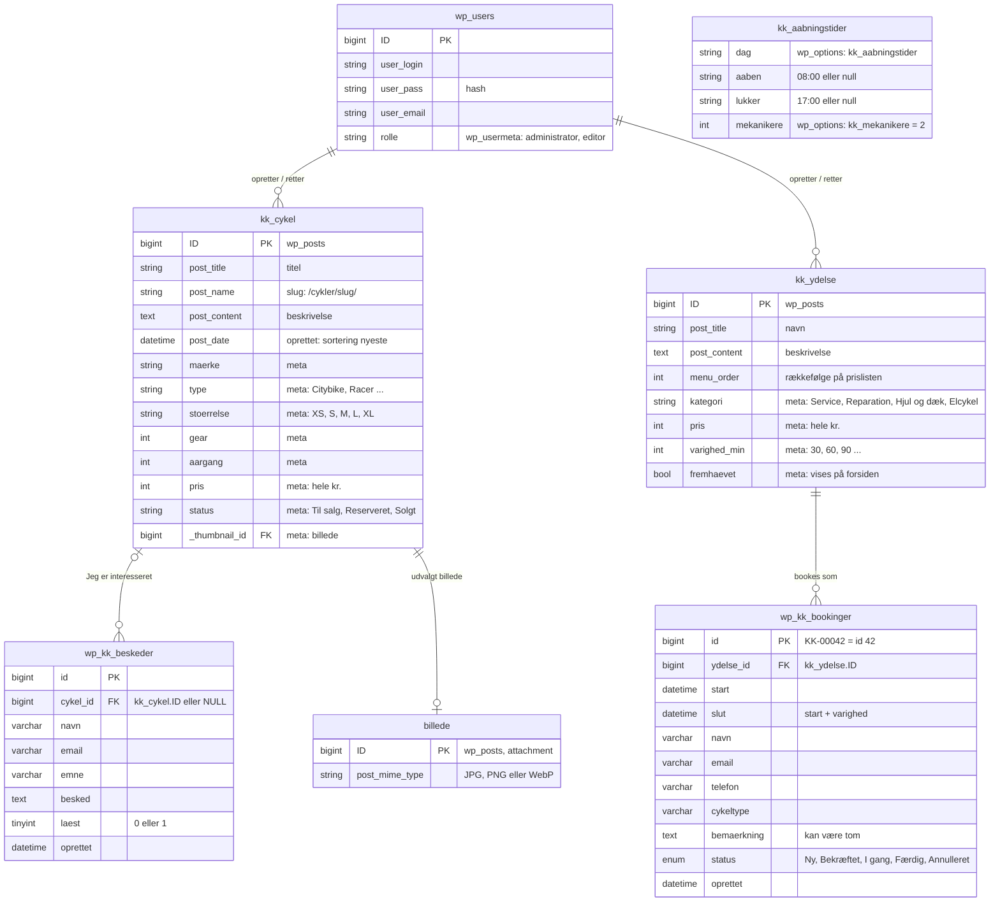

# Datamodel (D06 / T-05)

**Kæde & Krank** · Jonas Knudsen, Pixelværket · 19.11.2026 · Til godkendelse ved Milepæl 2

Bygger på beslutningsnotatet: **ydelser og cykler er post types** i WordPress (`wp_posts` + felter i `wp_postmeta`), **bookinger og beskeder ligger i egne tabeller**, og **brugere er WordPress' egne** (`wp_users`). Åbningstiderne ligger som indstillinger i `wp_options`.

## ER-diagram

Samme diagram som billede til Milepæl 2 og Trello: `datamodel.png`.

**Relationer**

| Fra | Til | Type | Gemt som | Betydning |
| --- | --- | --- | --- | --- |
| Booking | Ydelse | N:1 (skal) | `wp_kk_bookinger.ydelse_id` → `wp_posts.ID` | En booking hører til præcis én ydelse; en ydelse kan have mange bookinger (T-05). |
| Besked | Cykel | N:0..1 (kan) | `wp_kk_beskeder.cykel_id` → `wp_posts.ID` | Udfyldt ved "Jeg er interesseret" (C-06), `NULL` fra kontaktformularen (K-01). |
| Cykel | Billede | 1:0..1 | meta `_thumbnail_id` → attachment i `wp_posts` | Cyklens udvalgte billede (C-04, A-05). |
| Bruger | Cykel / ydelse | 1:N | `wp_posts.post_author` | Hvem der har oprettet indlægget. Bookinger og beskeder har ingen bruger, fordi kunderne ikke logger ind. |

WordPress bruger ikke fremmednøgler i databasen, og `ydelse_id`/`cykel_id` peger ind i `wp_posts`. Relationerne holdes derfor i PHP: ved booking tjekkes det, at `ydelse_id` er en udgivet `kk_ydelse`, og ved "Jeg er interesseret", at `cykel_id` er en `kk_cykel`, der ikke er solgt.

## Ydelse — post type `kk_ydelse`

Ikke offentlig som egen side (vises samlet på prissiden). Redigeres i admin (A-08).

| Felt | Gemt i | Datatype | Regler | Krav |
| --- | --- | --- | --- | --- |
| ID | `wp_posts.ID` | BIGINT | Bruges i `?ydelse=` og i bookingen | Y-03 |
| Navn | `post_title` | tekst | Påkrævet | Y-02 |
| Beskrivelse | `post_content` | tekst | | Y-02 |
| Rækkefølge | `menu_order` | heltal | Rækkefølgen fra kundens prisliste | Y-01 |
| `kategori` | `wp_postmeta` | string | Service, Reparation, Hjul og dæk, Elcykel | Y-01 |
| `pris` | `wp_postmeta` | integer | Hele kroner, ≥ 0 | Y-02 |
| `varighed_min` | `wp_postmeta` | integer | Min. 30, rundes op til hele halve timer | Y-02, B-03 |
| `fremhaevet` | `wp_postmeta` | boolean | Vises på forsiden | F-02 |

## Cykel — post type `kk_cykel`

Offentlig med egen side på `/cykler/<slug>/` (C-04). Redigeres i admin (A-05).

| Felt | Gemt i | Datatype | Regler | Krav |
| --- | --- | --- | --- | --- |
| ID | `wp_posts.ID` | BIGINT | | C-04 |
| Titel | `post_title` | tekst | Påkrævet | C-01 |
| Slug | `post_name` | tekst | Unik, laves af WordPress ud fra titlen | C-04 |
| Beskrivelse | `post_content` | tekst | | C-04 |
| Oprettet | `post_date` | DATETIME | Fra CSV'en; bruges til "nyeste" | C-03, F-04 |
| `maerke` | `wp_postmeta` | string | | C-04 |
| `type` | `wp_postmeta` | string | Citybike, Racer, Mountainbike, Gravel, Elcykel, Børnecykel | C-02 |
| `stoerrelse` | `wp_postmeta` | string | XS, S, M, L, XL | C-02 |
| `gear` | `wp_postmeta` | integer | ≥ 1 | C-04 |
| `aargang` | `wp_postmeta` | integer | ≥ 1900 | C-04 |
| `pris` | `wp_postmeta` | integer | Hele kroner, ≥ 0 | C-02, C-03 |
| `status` | `wp_postmeta` | string | Til salg, Reserveret, Solgt. Solgte sendes ikke i JSON og giver 404 | C-05 |
| Billede | `_thumbnail_id` → attachment | BIGINT | JPG, PNG eller WebP, højst 2 MB | A-05, T-07 |

## Booking — tabel `wp_kk_bookinger`

Oprettet med `sql/opret-tabeller.sql`. InnoDB, så B-07 kan bruge en transaktion.

| Kolonne | Datatype | Regler | Krav |
| --- | --- | --- | --- |
| `id` | BIGINT UNSIGNED, PK, AUTO_INCREMENT | Bookingnummer vises som `KK-` + id med 5 cifre (KK-00042). Gemmes ikke separat | B-06 |
| `ydelse_id` | BIGINT UNSIGNED, indeks | Skal være en udgivet `kk_ydelse` | T-05, B-01 |
| `start` | DATETIME, indeks | Hver halve time inden for åbningstiden, fra i morgen til +30 dage | B-03, B-04, A-04 |
| `slut` | DATETIME | `start` + ydelsens varighed, gemt ved booking. Gør overlap-tjekket til én simpel forespørgsel, og bookingen ændrer sig ikke, hvis varigheden rettes senere | B-03 |
| `navn` | VARCHAR(100) | Påkrævet | B-01, B-05 |
| `email` | VARCHAR(190) | Påkrævet, gyldig e-mail | B-01, B-05 |
| `telefon` | VARCHAR(30) | Påkrævet | B-01, B-05 |
| `cykeltype` | VARCHAR(50) | Dropdown; skal være en af de faste typer | B-01 |
| `bemaerkning` | TEXT, NULL | Valgfri | B-01 |
| `status` | ENUM | Ny (standard), Bekræftet, I gang, Færdig, Annulleret | B-06, A-04 |
| `oprettet` | DATETIME | Tidspunkt for bookingen | A-03 |

**Ledig tid (B-03):** en ny booking må gemmes, hvis der er færre end `kk_mekanikere` (2) bookinger med `status <> 'Annulleret'`, hvor `start < ny_slut AND slut > ny_start`, og `ny_slut` ikke ligger efter lukketid.

## Besked — tabel `wp_kk_beskeder`

| Kolonne | Datatype | Regler | Krav |
| --- | --- | --- | --- |
| `id` | BIGINT UNSIGNED, PK, AUTO_INCREMENT | | A-06 |
| `cykel_id` | BIGINT UNSIGNED, NULL, indeks | Cyklens ID ved "Jeg er interesseret", ellers `NULL` | C-06 |
| `navn` | VARCHAR(100) | Påkrævet | K-01 |
| `email` | VARCHAR(190) | Påkrævet, gyldig e-mail | K-01 |
| `emne` | VARCHAR(150) | Påkrævet. Sættes automatisk ved "Jeg er interesseret" | K-01 |
| `besked` | TEXT | Påkrævet | K-01 |
| `laest` | TINYINT(1), indeks | 0 = ulæst (standard), 1 = læst. Tælles til overblikket | A-03, A-06 |
| `oprettet` | DATETIME | | A-06 |

Honeypot-feltet (K-04) gemmes ikke.

## Brugere — WordPress' `wp_users`

| Bruger | Rolle (`wp_usermeta`) | Må |
| --- | --- | --- |
| admin (Jonas) | Administrator | Alt, inkl. plugins og indstillinger |
| Sofie | Redaktør (editor) | Cykler, ydelser, bookinger og beskeder |

Adgangskoder gemmes hashet af WordPress (A-01). De egne admin-sider til bookinger og beskeder skal kræve en rettighed, som både Redaktør og Administrator har (fx `edit_others_posts`), ellers kan Sofie ikke se dem.

## Åbningstider — `wp_options`

| Option | Indhold | Krav |
| --- | --- | --- |
| `kk_aabningstider` | Liste med `dag`, `aaben`, `lukker` (`null` = lukket) fra `aabningstider.json` | F-03, K-02, B-03 |
| `kk_mekanikere` | 2 = højst 2 overlappende bookinger | B-03 |

## Åbne punkter

1. **Ydelsen "Andet"** (min. 1 time, aftalt 17.11) mangler. Forslag: én `kk_ydelse` med kategorien "Andet", varighed 60 og pris 0 vist som "Pris efter aftale". Kræver at "Andet" tilføjes i `kk_valg()['kategori']`.
2. **Sletning af en ydelse med bookinger:** så peger `ydelse_id` på en ydelse, der ikke findes. Forslag: ydelser lægges i papirkurven i stedet for at slettes helt, og admin-listen viser "(slettet ydelse)", hvis den mangler.
3. **`oprettet` og tidszone:** `DEFAULT CURRENT_TIMESTAMP` bruger MySQL-serverens tid, som på cPanel kan være UTC. Sæt `oprettet` fra PHP med `current_time('mysql')` ved insert, så alle tider er dansk tid som `start` og `slut`.
4. **C-06 på reserverede cykler** afgøres senere med kunden. Modellen understøtter begge dele.
